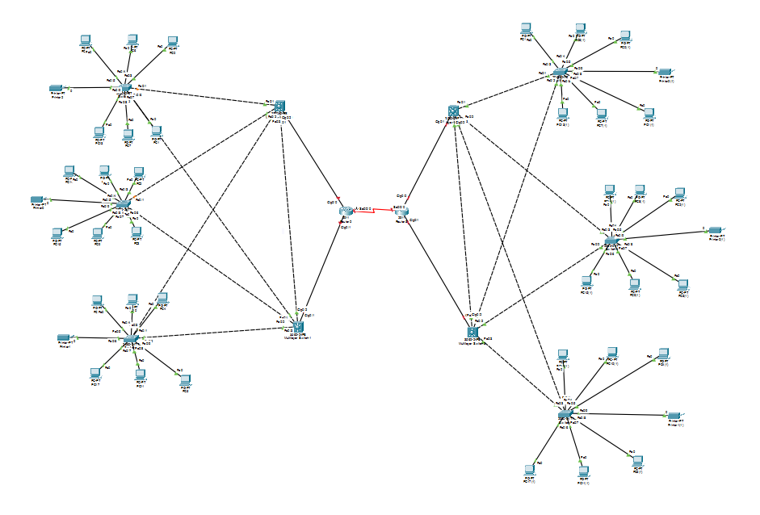

# Multi-Building Enterprise Campus Network Infrastructure

A robust, redundant enterprise network architecture designed and simulated in **Cisco Packet Tracer**. This project models connectivity across two distinct facilities (Building A and Building B), incorporating multi-tier switching, routing redundancy, and segmented departmental access layers.

---

## 📌 Topology Overview



The infrastructure follows standard Cisco hierarchical design principles (Access, Distribution, and WAN/Core Edge) to ensure scalability, fault tolerance, and high availability.

### Key Architecture Highlights
* **Inter-Building WAN Connection:** Point-to-point redundant serial/gigabit link connecting both building edge routers.
* **Distribution Layer Redundancy:** Dual distribution/multilayer switches per building to eliminate single points of failure (SPOF).
* **Access Layer Segmentation:** Star-topology access switches distributing wired connectivity across multiple departments/floors.

---

## ⚙️ Implemented Features & Technologies

* **Hierarchical Network Design:** Three-tier campus architecture (Core, Distribution, Access).
* **VLAN & Subnetting:** Department-level isolation and broadcast containment with inter-VLAN routing.
* **Spanning Tree Protocol (STP / Rapid-PVST):** Loop prevention across interconnected distribution switches.
* **Dynamic Routing (OSPF / EIGRP / Static):** End-to-end route propagation between Building A and Building B edge routers.
* **DHCP Services:** Centralized/router-assisted dynamic IP allocation for end workstations.
* **Redundant Uplinks:** Dual uplinks from access clusters to distribution nodes.

---

## 🏢 Infrastructure Breakdown

| Component | Quantity | Role |
| :--- | :---: | :--- |
| **Edge Routers** | 2 | Inter-building WAN connectivity and edge route filtering |
| **Distribution Switches** | 4 | Uplink aggregation, inter-VLAN control, and redundancy |
| **Access Switches** | 6 | Layer-2 end-user access aggregation |
| **Workstations (PCs)** | 30+ | End-user hosts distributed across departmental clusters |

---

## 🚀 How to Run the Project

1. Clone this repository:
   ```bash
   git clone [https://github.com/](https://github.com/)iAmitVishwakarma/enterprise-multi-building-network-packet-tracer.git
